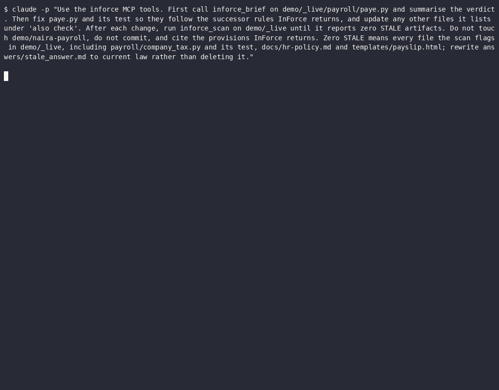

# InForce

[](https://github.com/subair99/in-force/actions/workflows/ci.yml)

**InForce finds every AI answer, line of code and document that still runs on repealed law, and shows what replaced it.** Built with Relate.

On 26 June 2025, Nigeria enacted four tax reform laws: the Nigeria Tax Act, the Nigeria Tax Administration Act, the Nigeria Revenue Service (Establishment) Act and the Joint Revenue Board of Nigeria (Establishment) Act. The two establishment Acts commenced on signing, to set up the institutions; the Nigeria Tax Act and the Nigeria Tax Administration Act took effect on **1 January 2026**. Under section 195 of the Nigeria Tax Act (s.196 in the gazetted text), the Personal Income Tax Act, the Companies Income Tax Act, the Capital Gains Tax Act, the VAT Act, the Industrial Development (Income Tax Relief) Act and other tax laws were repealed from that date.

Payroll code, HR policies and AI assistants written before 2026 still use the old rules. InForce finds where.

*InForce checks whether a provision is in force. It is not legal or tax advice.*

**Try it in your browser:** https://subair99.github.io/in-force/ (paste an answer or document; nothing leaves your browser).



## First result in 60 seconds

```bash
git clone https://github.com/subair99/in-force.git && cd in-force
python3 -m venv .venv && . .venv/bin/activate      # Windows: py -3.11 -m venv .venv; .venv\Scripts\activate
make install        # Windows without make: python -m pip install -e ".[dev,embed]"
make demo           # Windows without make: inforce load --allow-unverified; inforce demo --fast
```

If `python3 -m venv` fails on Debian/Ubuntu, install `python3-venv` (or use `uv venv --python 3.11 --seed .venv`). No API keys and no network beyond the package install. `make demo` runs the whole story on a temporary copy of a synthetic payroll repo and checks each step:

```
  PASS  law pack: 17 rules loaded
  PASS  stale answer: verdict STALE, 6 claims rest on repealed law
  PASS  stale repo: 13 STALE artifacts
  PASS  keystones: top keystone: ng.pit.cra.old (8 artifacts)
  PASS  brief: 7 items to re-check
  PASS  fixed repo: 13 STALE before, 0 after
  PASS  fixed answer: verdict SUSPECT
  PASS  ask: top rule ng.pit.cra.old (hybrid)
  PASS  what-if (repo): 5 artifacts would turn STALE; both stores restored
  PASS  what-if (law): 1 grant(s) would fall
  PASS  diff: s.156(5) -> s.155(4), s.183(2) -> s.182(2), s.196 -> s.195, s.203 -> long title (Commencement)
```

The "fixed repo" step replays the edits a real Claude Code session made through InForce's MCP tools ([transcript](demo/transcripts/agent-session.md)), so the demo needs no model. "SUSPECT" means current law that a human has not yet verified against the Act's text (see [Data and accuracy](#data-and-accuracy)).

## Use case

Developers of Nigerian payroll, accounting and tax-assistant software, and the people who paste AI answers into reports, need to know which of their code, tests, policies and answers still rest on the repealed Acts, and what replaced each rule. A search for "PITA" does not find a `CRA_RATE = 0.20` constant, the test that pins its result, or the payslip template that prints it. What matters are relationships: an Act `REPEALS` another, a section `SAVES` existing grants, an old section is `SUCCEEDED_BY` a new one, a rule is `REPLACED_BY` another, code `ENCODES` a rule, a document's claim `CITES` it, and tests and callers depend on the code (`TESTED_BY`, `USED_BY`). InForce walks those relationships for a given date: it marks the artifact STALE, shows the path that proves it, and lists everything that must be re-checked with it.

```
$ inforce check "Under PITA the first ₦300,000 is taxed at 7%." --on 2026-11-25
text on 2026-11-25: STALE
│ 1 │ 1 │ PITA                          │ REPEALED * │ 2026-01-01 │ Nigeria Tax Act, 2025                   │
│ 2 │ 1 │ first ₦300,000 is taxed at 7% │ REPEALED * │ 2026-01-01 │ NTA s. 58 + Fourth Schedule (whole      │
│   │   │                               │            │            │ scale): PIT: first NGN 800,000 at 0% ·  │
│   │   │                               │            │            │ PIT: next NGN 2,200,000 at 15% · ...    │
Why
  2. Rule ng.pit.band1.old <-SETS- Provision TODO/ng/act/pita/sec_bands <-CONTAINS- Instrument PITA
     <-REPEALS 2026-01-01- Instrument NTA -SUCCEEDED_BY-> Provision akn/ng/act/2025/7/sec_58
```

## How it uses Relate

- **Mode:** embedded, single-file stores (`.rl`), used twice, through the Python package `relate-db` (1.3.0) and the `relate` CLI.
  - `data/ng-tax-2026.rl` is the **law pack**: Acts, provisions, rules, repeals, savings, successors and sources. It is built from `data/rules/*.yaml` by `inforce load` and read-only at runtime.
  - `<your repo>/.inforce/project.rl` is the **project graph**: the repo's code constants, functions, tests, documents and recorded AI answers, linked to a copy of the slice of law they rest on. It is written by `inforce scan` and by agents, and committed with the code.
- **Why this mode:**
  - **One file, no server.** The law pack is one inspectable file that ships with the code like a dataset. The project graph is committed like a lockfile, so a pull request shows the re-check list changing.
  - **Opened per command.** Every command opens a store, works, and closes it. A `.rl` file cannot be opened at all, even read-only, while a writer holds it, so a long-lived connection would lock out the scanner, the agent and the CLI.
  - **Retries on a lock.** A second writer gets "storage locked" (exit 5) and retries with backoff (`python scripts/two_writers.py` shows it).
  - **One graph per statement.** One statement reads one graph, so `scan` copies the law it needs into the project graph, and every verdict about a repo is a query on that one graph.
- **What the graph models:**

  | Node | Key | | Relationship | Meaning |
  |---|---|---|---|---|
  | `Instrument` | `akn` | | `(Instrument)-[:CONTAINS]->(Provision)-[:SETS]->(Rule)` | structure |
  | `Provision` | `akn` | | `(Instrument)-[:REPEALS {on}]->(Instrument\|Provision)` | repeal on a date |
  | `Rule` | `id` | | `(Provision)-[:SAVES {until}]->(Grant\|Provision)` | savings clause |
  | `Grant` | `id` | | `(Provision)-[:SUCCEEDED_BY]->(Provision)` | replaced as a whole (the PIT scale) |
  | `Source` | `url` | | `(Rule)-[:REPLACED_BY]->(Rule)` / `-[:RELATED]->` | one-to-one successor / related, not a successor |
  | `Version` | `key` | | `(Instrument)-[:HAS_VERSION]->(Version {recordedAt, closedAt})` | which published text was on record when |
  | | | | `(Provision)-[:NUMBERED_AS {number, page}]->(Version)` | section number in each edition (gazetted s.183(2) = certified s.182(2)) |
  | `Artifact` | `id` | | `(Artifact)-[:ENCODES]->(Rule)` | code built on a rule |
  | `Claim` | `id` | | `(Artifact)-[:HAS_CLAIM]->(Claim)-[:CITES]->(Rule\|Provision\|Instrument)` | citations in documents and answers |
  | | | | `(Artifact)-[:USED_BY\|TESTED_BY]->(Artifact)` | callers and tests (followed forward, up to 3 hops) |

  **The rule:** a provision is in force on a date from its own `validFrom` (or its Act's commencement) until the earliest of its own `validTo`, a repeal of the provision, or a repeal of its Act. A savings provision that is itself in force keeps it alive. An artifact is STALE if it encodes or cites law repealed on that date, or uses or tests such an artifact. Statuses are always computed for the date asked; nothing is stored as truth.
- **Relate features used:**
  - embedded Python;
  - Cypher with `EXISTS {}`, variable-length paths, label alternation and dynamic labels/types (`$(…)`) for copying law between stores;
  - transactions with rollback (`whatif repeal`);
  - unique constraints;
  - vector and full-text `SEARCH` (`ask`), with rule embeddings stored in the pack;
  - safe mode (`--safe`; every read query has a `LIMIT`, tested);
  - Relate's own MCP server (`relate serve --mcp stdio --read-only --safe`, tools `read_cypher` and `get_schema`) next to InForce's;
  - the Relate agent skill.

  Every query lives in [`inforce/queries/`](inforce/queries), one per file.

## Setup and run

Prerequisites: Python 3.11+. The [Relate CLI](https://relatedb.ai) is optional: InForce runs on the Python package. The CLI is used for raw inspection, Relate's MCP server and the safe-mode tests (they are skipped without it).

```bash
curl -sSfL https://relatedb.ai/install.sh | bash      # macOS/Linux
# Windows (PowerShell): powershell -ExecutionPolicy ByPass -c "irm https://relatedb.ai/install.ps1 | iex"
make install                                          # or: python -m pip install -e ".[dev,embed]"
make test                                             # pytest
```

Tested on Linux (Ubuntu in CI, and WSL2). The Windows commands are given but have not been tested.

| Command | What it does |
|---|---|
| `inforce check FILE\|"text" [--on D] [--json] [--record REPO]` | each citation and tax figure: in force, repealed (with successor) or not recognised; exit 3 if anything is stale |
| `inforce scan DIR [--on D]` | link code, tests, docs and templates to the law; writes `DIR/.inforce/project.rl`; lists STALE artifacts and what uses or tests them |
| `inforce brief FILE\|"question"` | one screen before editing: VERDICT, TRUTH, WHY, WHAT RESTS ON IT, RE-CHECK LIST |
| `inforce keystones DIR` | the rules the repo rests on most |
| `inforce whatif repeal AKN\|ACT [--repo DIR]` | what would fall, measured in a transaction and rolled back (counts and fingerprint before, during and after) |
| `inforce ask "question" --on D` | hybrid rule search (citations, amounts, vectors, full-text) with status on the date |
| `inforce fallout ACT` | grants that fell or were saved when an Act was repealed |
| `inforce diff --known-on D1 --known-on D2` | which published edition of each Act was on record on each date, and the section numbers that differ between them |
| `inforce verify [--summary\|--sheet F\|--apply F]` | the human checklist for verifying entries against the Act |
| `inforce serve` | MCP server (stdio) with `inforce_check`, `inforce_brief`, `inforce_scan` |
| `inforce export` | `web/export.json` for the browser checker |

### Use it from your coding agent (Claude Code)

From the repo root, with the virtualenv active so `inforce` is on your `PATH`:

```bash
cp .mcp.json.example .mcp.json                      # two MCP servers: inforce + Relate's own (read-only law pack)
mkdir -p .claude/skills/inforce && cp skill/SKILL.md .claude/skills/inforce/
claude                                              # approve the two project MCP servers when asked
claude mcp list                                     # inforce and relate-law should show as connected
```

| MCP server | Tools | What it gives the agent |
|---|---|---|
| `inforce` (`inforce serve`) | `inforce_check`, `inforce_brief`, `inforce_scan` | verdicts, successor rules, proof paths and re-check lists (JSON) |
| `relate-law` (`relate serve --mcp stdio --read-only --safe`) | `read_cypher`, `get_schema` | raw read-only Cypher on the law pack |

The skill tells the agent to:
- check a draft answer before sending it;
- brief a tax file before editing it;
- rescan until nothing is STALE.

Pass `record_in` to `inforce_check` (or `--record <repo>` on the CLI) to store the answer in that repo's project graph next to the code; later scans also flag AI answers that rest on repealed law. [`demo/transcripts/`](demo/transcripts) has two recorded sessions:
- **Fixing the demo repo:** the agent takes it from 13 STALE artifacts to 0.
- **An earlier run:** the law pack lacked three PAYE bands, and the agent refused to invent them.

## Where the data lives

- **Law pack:** `data/ng-tax-2026.rl`, built from [`data/rules/ng-tax-2026.yaml`](data/rules/ng-tax-2026.yaml). Each entry has its source link.
- **Demo project graph:** `demo/naira-payroll/.inforce/project.rl`, made by scanning the synthetic repo in `demo/naira-payroll/`.
- **Browser data:** `web/export.json`, with statuses computed by Cypher at each date where a status can change.

Inspect them yourself (read-only):

```bash
make inspect
relate --database data/ng-tax-2026.rl --read-only --mode table \
  "MATCH (i:Instrument)-[r:REPEALS]->(old) RETURN i.short AS act, old.title AS repealed, r.on AS on ORDER BY repealed LIMIT 20"
relate --database demo/naira-payroll/.inforce/project.rl --read-only --mode table \
  "MATCH (a:Artifact)-[:ENCODES]->(r:Rule) RETURN a.id AS artifact, r.text AS rule ORDER BY artifact LIMIT 20"
```

```
| act   | repealed                                         | on         |
| "NTA" | "Capital Gains Tax Act"                          | 2026-01-01 |
| "NTA" | "Companies Income Tax Act"                       | 2026-01-01 |
| "NTA" | "Industrial Development (Income Tax Relief) Act" | 2026-01-01 |
| "NTA" | "Personal Income Tax Act"                        | 2026-01-01 |
| "NTA" | "Value Added Tax Act"                            | 2026-01-01 |

| artifact                           | rule                                                                     |
| "payroll/company_tax.py::CGT_RATE" | "Company capital gains taxed at 10%"                                     |
| "payroll/paye.py::CRA_FLAT_MIN"    | "CRA: 20% of gross income plus the higher of NGN 200,000 or 1% of gross" |
| "payroll/paye.py::CRA_RATE"        | "CRA: 20% of gross income plus the higher of NGN 200,000 or 1% of gross" |
| "payroll/paye.py::PIT_BANDS_2025"  | "PIT: first NGN 300,000 at 7%"                                           |
| "payroll/paye.py::PIT_BANDS_2025"  | "PIT: next NGN 300,000 at 11%"                                           |
```

## Data and accuracy

- **What is stored:** identifiers, dates, relationships, rule values and short summaries in our own words. Nigeria Tax Act entries cite both official editions (the gazetted text and the certified copy, with page numbers); entries for the repealed Acts cite published commentary (sources in `data/rules/*.yaml`). No Act text is copied.
- **Status:** <!-- inforce:verify-status -->Each rule links to its source; verification against the Act's text is in progress (24 of 47 law entries verified).<!-- /inforce:verify-status -->
- **Checking entries:** `make verify` lists every entry with its source and verified flag. `inforce verify --sheet` makes a checklist grouped by section of the Act, and `inforce verify --apply` records the ticks. The loader refuses unverified entries unless `--allow-unverified` is given; the demo uses that flag. Until an entry is verified, every verdict that rests on it is marked unverified.
- **Synthetic demo:** the demo payroll repo is synthetic, with no real people, salaries or employers.

## Built with

- **Libraries:** Relate (`relate-db` 1.3.0 and the `relate` CLI), Python, Typer, Rich, PyYAML, the MCP Python SDK and model2vec (`minishlab/potion-base-8M`, local CPU embeddings). The demo recordings use asciinema and agg.
- **AI tools:** Claude Code (Anthropic; model Claude Opus 5.5) wrote most of the code, tests and documentation in this repo under the author's direction. The author set the scope, specification and plan, made the design decisions, supplied the law data and reviewed the changes. The sessions in `demo/transcripts/` are Claude Code using InForce through MCP. In the author's words: "Rules were checked against both official editions of the Nigeria Tax Act (gazetted and certified) with Claude reading the scans; I reviewed the results. Rules from the repealed Acts are sourced from published commentary and are not yet verified."
- **Reused work:** none, beyond the libraries listed.

## Limits and what's next

- **Partly verified law data:** the Nigeria Tax Act entries have been checked against both official editions; the rules from the repealed Acts come from published commentary and are not yet verified, and some old-Act section numbers are still `TODO`. Only Nigerian federal tax is covered, and only the rules in the pack.
- **Explicit patterns:**
  - `scan` and `check` match the patterns in `patterns/`, not every way of writing a rule. They follow Python `from x import y`, but not `import x` with attribute use.
  - Code comments are not scanned.
  - A claim that matches no rule is reported as "not recognised", never guessed.
- **Text differences:** `diff --known-on` knows which version of an Act was on record, but no text-level differences between versions are recorded yet.
- **Next:**
  - law packs for other countries in Akoma Ntoso identifiers;
  - state tax laws;
  - a GitHub Action that comments the re-check list on pull requests;
  - the browser checker running Relate itself (WebAssembly + OPFS).

## License

MIT
